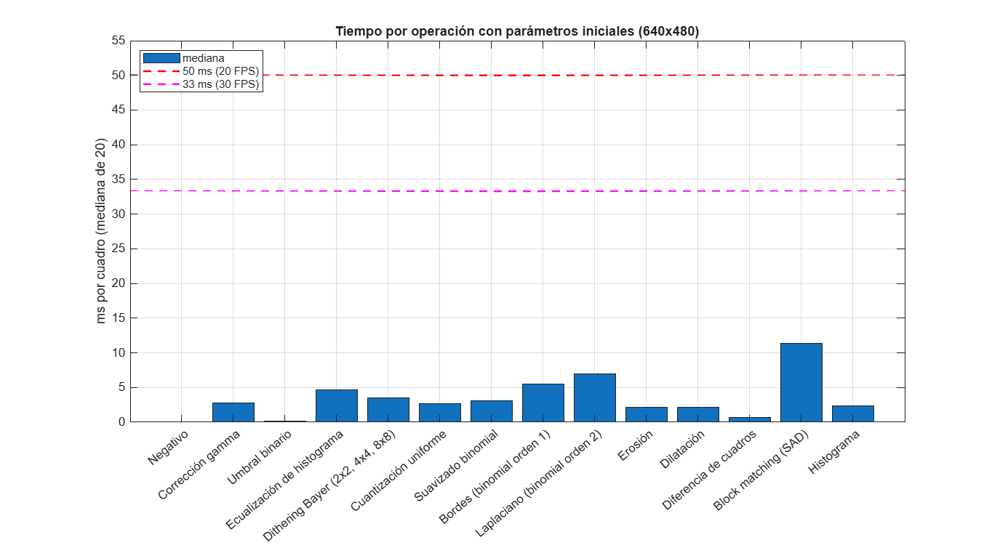
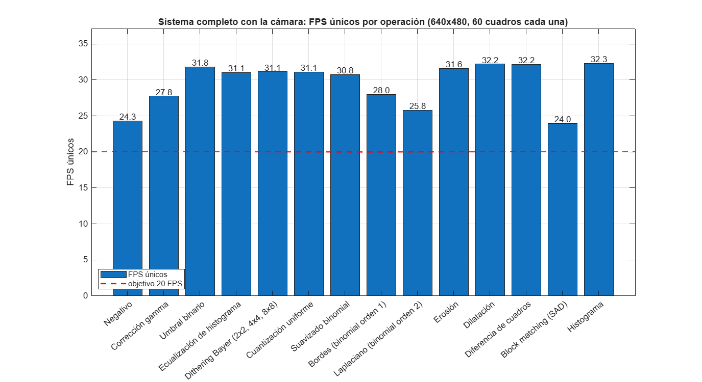

# Evaluación experimental de PDI VisionLab

Aquí están los tiempos de cada operación sola, los FPS del sistema completo con la cámara, el efecto de los parámetros en el tiempo y en la calidad, y la limitación que pone la cámara. Todos los datos y figuras están en `figuras/` (las rutas son relativas a `documentacion/experimentos/`).

Scripts que generan los datos:

- `experimentos/medir_todo.m`: tiempo de cada operación sola y barridos de parámetros (`figuras/tiempos_operaciones.csv`, `figuras/barridos.csv` y sus PNG).
- `principal(struct('recorrer', true, 'cuadros_por_op', 60))`: sistema completo con la cámara, 60 cuadros únicos por operación (`figuras/recorrido_camara.csv`).
- `experimentos/grafica_fps_sistema.m`: gráfica de FPS del sistema (`figuras/fps_sistema.png`).
- `experimentos/calidad_visual.m`: mosaicos y PSNR (`figuras/mosaico_*.png`, `figuras/calidad.csv` y `recursos/imagenes_prueba/cuadro_prueba.png`).

## Condiciones y hardware

| Concepto | Valor |
|----------|-------|
| Equipo | Laptop HUAWEI NBM-WXX9 |
| Procesador | AMD Ryzen 5 5500U with Radeon Graphics, 6 núcleos, 12 procesadores lógicos |
| RAM | 7.3 GB (TotalPhysicalMemory) |
| Sistema operativo | Microsoft Windows 11 Home Single Language, versión 10.0.26200 |
| Software | MATLAB R2026b en modo `-batch`, una sola instancia, sin otra carga |
| Cámara | `HD Camera` integrada, backend `webcam` del MATLAB Support Package for USB Webcams |
| Resoluciones de la cámara | 1280x720, 960x540, 848x480, 640x480, 640x360 |
| Resolución usada | 640x480 |
| Exposición | Manual -5, brillo 100, gamma 100 (`configuracion.m`) |
| Medición | `tic`/`toc` por etapa; la operación se mide igual que en `Pipeline.procesar` |

En el recorrido la ventana sí se abre, así que el despliegue incluye dibujar las dos imágenes. La memoria es la que usa MATLAB (`memory`, MemUsedMATLAB) al terminar cada operación. El CPU % es el tiempo de CPU del proceso entre dos muestras dividido entre el tiempo transcurrido por 6 núcleos; 100 % sería tener los 6 núcleos ocupados, así que 40 % equivale a unos 2.4 núcleos.

## Tiempo por operación aislada

Solo la llamada a la operación, sobre dos cuadros reales de la cámara en gris: 2 corridas de calentamiento y 20 medidas. FPS máx = 1000 / ms mediana, es el techo de la operación sola sin captura, gris ni despliegue.

| Operación | Parámetros | ms mediana | ms p90 | FPS máx |
|-----------|------------|-----------:|-------:|--------:|
| Negativo | - | 0.03 | 0.28 | 32000 |
| Corrección gamma | gamma=1 | 2.79 | 3.10 | 358 |
| Umbral binario | umbral=128 | 0.11 | 0.21 | 9412 |
| Ecualización de histograma | - | 4.71 | 5.36 | 213 |
| Dithering Bayer | orden=2 | 3.48 | 3.84 | 288 |
| Cuantización uniforme | niveles=8 | 2.65 | 2.86 | 377 |
| Suavizado binomial | longitud=5 | 3.07 | 3.84 | 326 |
| Bordes (binomial orden 1) | longitud=5; umbral=0 | 5.53 | 6.16 | 181 |
| Laplaciano (binomial orden 2) | longitud=3 | 6.93 | 7.63 | 144 |
| Erosión | tamano=5 | 2.17 | 2.42 | 462 |
| Dilatación | tamano=5 | 2.19 | 2.56 | 456 |
| Diferencia de cuadros | umbral=25 | 0.65 | 0.84 | 1550 |
| Block matching (SAD) | bloque=16; radio=3 | 11.34 | 14.80 | 88 |
| Histograma | - | 2.36 | 2.93 | 424 |

## Sistema completo con la cámara

Recorrido por las 14 operaciones con sus parámetros iniciales (block matching con radio 3), 60 cuadros únicos cada una. Los ms son medianas por cuadro único.

| Operación | FPS únicos | captura | gris | operación | despliegue | memoria MB | CPU % |
|-----------|-----------:|--------:|-----:|----------:|-----------:|-----------:|------:|
| Negativo | 24.3 | 22.67 | 2.92 | 0.15 | 2.74 | 1826 | 24.5 |
| Corrección gamma | 27.8 | 20.99 | 2.89 | 4.30 | 2.27 | 1832 | 27.4 |
| Umbral binario | 31.8 | 22.12 | 2.49 | 0.23 | 2.91 | 1834 | 27.2 |
| Ecualización de histograma | 31.0 | 19.36 | 2.53 | 6.02 | 2.64 | 1836 | 30.3 |
| Dithering Bayer | 31.1 | 20.08 | 2.51 | 4.31 | 2.76 | 1837 | 33.8 |
| Cuantización uniforme | 31.1 | 21.12 | 2.44 | 3.83 | 2.02 | 1837 | 27.3 |
| Suavizado binomial | 30.8 | 20.30 | 2.52 | 4.44 | 2.03 | 1858 | 27.7 |
| Bordes (binomial orden 1) | 28.0 | 18.30 | 2.51 | 9.36 | 2.69 | 1864 | 34.9 |
| Laplaciano (binomial orden 2) | 25.8 | 19.07 | 2.74 | 12.64 | 2.64 | 1870 | 35.3 |
| Erosión | 31.6 | 21.04 | 2.95 | 3.27 | 2.36 | 1869 | 26.6 |
| Dilatación | 32.2 | 21.83 | 2.40 | 3.23 | 2.12 | 1868 | 27.7 |
| Diferencia de cuadros | 32.2 | 24.62 | 2.41 | 1.02 | 2.33 | 1870 | 22.9 |
| Block matching (SAD) | 24.0 | 13.85 | 2.53 | 19.68 | 2.16 | 1931 | 40.5 |
| Histograma | 32.3 | 20.87 | 2.41 | 2.53 | 2.19 | 1929 | 24.8 |

Toda la corrida: 840 cuadros únicos en 28.7 s (29.3 FPS únicos; todas las lecturas fueron cuadros nuevos). Medianas de toda la corrida: captura 20.26, gris 2.58, operación 3.94 y despliegue 2.37 ms. MATLAB pasó de 1812 MB al inicio a 1929 MB al final y el CPU medio fue 29.6 %.

Las 14 operaciones quedan arriba de los 20 FPS. Las más bajas son negativo (24.3, pero es la primera del recorrido y carga el arranque de la ventana), block matching (24.0) y laplaciano (25.8). Dentro del lazo las operaciones tardan más que solas: el laplaciano 12.6 ms contra 6.9, bordes 9.4 contra 5.5 y block matching 19.7 contra 11.3. La cámara, la ventana y MATLAB compiten por el procesador y la memoria caché. La memoria sube unos 120 MB en toda la corrida; el salto más grande es el de block matching (61 MB), que guarda el cuadro anterior y la SAD de todos los desplazamientos.

## Barridos de parámetros

Mediana de 10 corridas por punto con la operación sola; los demás parámetros quedan en su valor inicial.

| longitud | 3 | 5 | 7 | 9 | 11 | 13 | 15 |
|----------|---|---|---|---|----|----|----|
| Binomial (ms) | 4.11 | 3.48 | 3.03 | 3.01 | 3.12 | 3.11 | 3.20 |
| Bordes (ms) | 5.70 | 5.57 | 5.64 | 5.67 | 5.81 | | |
| Laplaciano (ms) | 7.12 | 7.19 | 6.91 | 6.95 | 7.01 | | |

| tamano | 3 | 5 | 7 | 9 | 11 | 13 | 15 |
|--------|---|---|---|---|----|----|----|
| Erosión (ms) | 1.69 | 2.55 | 3.38 | 4.21 | 5.21 | 5.78 | 6.76 |
| Dilatación (ms) | 1.28 | 2.27 | 3.10 | 3.96 | 4.92 | 5.75 | 6.71 |

| radio (bloque 16) | 1 | 2 | 3 | 4 | 5 | 6 |
|-------------------|---|---|---|---|---|---|
| Block matching (ms) | 3.28 | 7.69 | 14.35 | 22.23 | 37.60 | 33.52 |

| bloque (radio 3) | 8 | 16 | 24 | 32 |
|------------------|---|----|----|----|
| Block matching (ms) | 14.58 | 15.87 | 11.05 | 9.86 |

Bayer tarda lo mismo con los tres órdenes (3.04 a 3.09 ms) y cuantización no sigue una tendencia con los niveles de 2 a 256 (2.85 a 4.89 ms). Los datos completos están en `figuras/barridos.csv`.

Gráficas: `figuras/barrido_binomial.png`, `figuras/barrido_bordes.png`, `figuras/barrido_laplaciano.png`, `figuras/barrido_bayer.png`, `figuras/barrido_cuantizacion.png`, `figuras/barrido_erosion.png`, `figuras/barrido_dilatacion.png`, `figuras/barrido_bm_bloque.png` y `figuras/barrido_bm_radio.png`.

## Calidad visual

Se usó la imagen estándar `peppers.png` de Image Processing Toolbox (384×512) en gris, ampliada a 640×480 con `imresize` bicúbico (`recursos/imagenes_prueba/cuadro_prueba.png`), y se le aplicó cada operación con varios valores del parámetro. Se eligió una imagen estándar para que el experimento sea reproducible en cualquier equipo, sin depender de la cámara ni de la luz. Cada mosaico tiene el original a la izquierda y luego una salida por valor, a tamaño real (cada píxel de la imagen es un píxel del PNG para que el patrón de Bayer no se deforme).

Para cuantización, Bayer y binomial se calculó el error contra el original con MSE = mean((double(a) - double(b)).^2) y PSNR = 10·log10(255² / MSE). Para Bayer la salida binaria se pasa a 0 y 255 antes de comparar.

| Operación | Parámetro | Valor | MSE | PSNR (dB) |
|-----------|-----------|------:|----:|----------:|
| Cuantización | niveles | 2 | 814.89 | 19.02 |
| Cuantización | niveles | 4 | 349.17 | 22.70 |
| Cuantización | niveles | 8 | 66.50 | 29.90 |
| Cuantización | niveles | 32 | 5.69 | 40.58 |
| Bayer | orden | 1 (2x2) | 12885.46 | 7.03 |
| Bayer | orden | 2 (4x4) | 12008.74 | 7.34 |
| Bayer | orden | 3 (8x8) | 12021.72 | 7.33 |
| Binomial | longitud | 3 | 3.36 | 42.87 |
| Binomial | longitud | 7 | 12.23 | 37.26 |
| Binomial | longitud | 15 | 27.41 | 33.75 |

La imagen es oscura: los grises van de 8 a 255 con media 81.7. Por eso con 2 niveles (64 y 192) casi todos los píxeles caen en el nivel oscuro.

- Cuantización: cada vez que se duplican los niveles el PSNR sube entre 3.7 y 10.7 dB (19.0, 22.7, 29.9 y 40.6 dB para 2, 4, 8 y 32 niveles; de 8 a 32 son dos duplicaciones, unos 5.3 dB cada una). La regla de unos 6 dB por duplicación vale cuando los grises se reparten de forma uniforme y se cumple solo de 8 niveles en adelante. El error uniforme MSE ≈ Δ²/12 con Δ = 256/L da 85.3 para 8 niveles (medido 66.5) y 5.3 para 32 niveles (medido 5.69); con pocos niveles la aproximación falla porque los grises de esta imagen no se reparten de forma uniforme. Desde 32 niveles la imagen se ve casi igual a la original; con 4 y 8 aparecen contornos falsos en las zonas de degradado.
- Bayer: el PSNR sale muy bajo (alrededor de 7 dB) en los tres órdenes porque se compara píxel por píxel una imagen binaria contra una en gris. El PSNR no mide lo que hace el tramado: el ojo promedia el patrón (como el filtro pasa bajas de la MTF de la práctica 1) y ve los grises. Al subir el orden el patrón es más fino y se ven más niveles (5, 17 y 65), aunque el PSNR casi no cambia (7.03, 7.34 y 7.33 dB).
- Binomial: aquí el PSNR mide qué tanto se aleja la imagen suavizada del original, no qué tanto ruido quita. Con longitud 3 casi no cambia (42.9 dB) y baja a 37.3 dB con 7 y a 33.8 dB con 15, donde ya pierde detalle fino.

Mosaicos:

| Operación | Archivo |
|-----------|---------|
| Bayer, orden 1, 2, 3 | `figuras/mosaico_bayer_orden_1_2_3.png` |
| Cuantización, niveles 2, 4, 8, 32 | `figuras/mosaico_cuantizacion_niveles_2_4_8_32.png` |
| Binomial, longitud 3, 7, 15 | `figuras/mosaico_binomial_longitud_3_7_15.png` |
| Bordes, longitud 3 y 7, umbral 0 | `figuras/mosaico_bordes_u0_longitud_3_7.png` |
| Bordes, longitud 3 y 7, umbral 60 | `figuras/mosaico_bordes_u60_longitud_3_7.png` |
| Laplaciano, longitud 3 y 7 | `figuras/mosaico_laplaciano_longitud_3_7.png` |
| Erosión, tamano 3, 7, 15 | `figuras/mosaico_erosion_tamano_3_7_15.png` |
| Dilatación, tamano 3, 7, 15 | `figuras/mosaico_dilatacion_tamano_3_7_15.png` |
| Gamma 0.5, 1, 2 | `figuras/mosaico_gamma_gamma_0p5_1_2.png` |
| Umbral 64, 128, 192 | `figuras/mosaico_umbral_umbral_64_128_192.png` |

En bordes, una longitud mayor da bordes más gruesos y menos puntos sueltos por ruido; con umbral 60 solo quedan los contornos fuertes. En la erosión en gris crecen las zonas oscuras: con tamano 15 los hilos del atrapasueños se vuelven una mancha oscura, los brillos pequeños desaparecen y se notan bloques cuadrados por la forma del elemento estructurante. La dilatación hace lo contrario: crecen las zonas claras y se pierden los detalles oscuros finos; con tamano 15 los hilos del atrapasueños ya casi no se ven.

## Limitación de la cámara

- Con exposición automática y poca luz la cámara alarga la exposición y solo entrega de 9 a 15 cuadros únicos por segundo, aunque se lean más (los demás son repetidos). Con exposición manual -5 entrega unos 30 cuadros únicos por segundo, y el brillo y la gamma compensan la imagen más oscura. Por eso `configuracion.m` usa -5.
- `snapshot` se queda esperando hasta que llega el siguiente cuadro de la cámara. Por eso el sistema no puede pasar de unos 30 FPS aunque la operación tarde casi nada (umbral: 0.23 ms y 31.8 FPS).
- Dentro del lazo la captura mide unos 20 ms y no lo que tarda en sí copiar el cuadro. Mientras se procesa el cuadro anterior la cámara ya está capturando el siguiente, así que la captura solo mide lo que falta del periodo de 33 ms. Si el procesamiento tarda más, la captura mide menos: con block matching baja a 13.9 ms.

## Discusión

**Qué cabe en 50 ms.** Para 20 FPS cada cuadro tiene 50 ms. Gris (2.5 ms) y despliegue (2 a 3 ms) gastan unos 5 ms, así que a la operación le quedan unos 45 ms. Todas las operaciones con sus parámetros iniciales caben de sobra: solas tardan menos de 7 ms, salvo block matching (11.3 ms). Como la cámara entrega un cuadro cada 33 ms, en la práctica el límite es otro: si gris + operación + despliegue pasan de unos 30 ms, ya no da tiempo de tomar el siguiente cuadro y se espera al que sigue.

**Cómo escala cada parámetro.**

- Erosión y dilatación crecen lineal con el lado n, unos 0.4 ms por unidad (ajuste por mínimos cuadrados: 0.42 ms por unidad en erosión y 0.45 en dilatación). El mínimo o máximo separable hace 2(n−1) comparaciones por píxel. Con n = 15 siguen abajo de 7 ms.
- Block matching sigue a (2R+1)², el número de desplazamientos que se prueban. Con mínimos cuadrados sobre el barrido de radio: t ≈ 0.214·(2R+1)² + 3.59 ms (R² = 0.88; el punto de radio 5, 37.6 ms, queda por encima del de radio 6, 33.5 ms, y es ruido de la medición). El bloque no sigue una tendencia clara (9.9 a 15.9 ms) porque cada desplazamiento recorre toda la imagen; solo cambia cuántos vectores salen.
- Binomial, bordes y laplaciano son filtros separables: se aplica un kernel en columnas y otro en filas, así que el costo crece con N y no con N². Para N de 3 a 15 el tiempo es casi constante (binomial de 3.0 a 4.1 ms, bordes y laplaciano de 5.6 a 7.2 ms) porque domina recorrer la imagen y replicar los bordes.
- Bayer, cuantización, gamma y umbral son una tabla o una comparación por píxel; el parámetro no cambia el tiempo.

**Block matching con radio 4 y con radio 3.** Con radio 4 la operación sola tarda unos 22 ms (barrido de radio), pero dentro del lazo sube a unos 31 ms. Sumando gris y despliegue el cuadro tarda unos 35 ms, más que los 33 ms entre cuadros de la cámara, así que muchas veces se pierde un cuadro y se espera al siguiente. En un recorrido con radio 4 el sistema quedó en 18.1 FPS, con operación de 31.0 ms y captura de 14.0 ms (`figuras/recorrido_camara_radio4.csv`, 40 cuadros por operación). Con radio 3 se prueban 49 desplazamientos en vez de 81: la operación sola tarda 11.3 ms (14.3 ms en el barrido), dentro del lazo 19.7 ms, y el sistema sube a 24.0 FPS. Por eso el radio inicial es 3 y el máximo del deslizador es 6 (unos 34 ms sola, ya no cumple 20 FPS en el lazo).

**Compromiso calidad/tiempo.** En las operaciones de tabla o de comparación por píxel (cuantización, Bayer, gamma, umbral) la calidad se elige sin pagar tiempo: 32 niveles dan 40.6 dB con el mismo costo que 2 niveles. En los filtros separables una longitud mayor cambia mucho el resultado (más suavizado, bordes más limpios) y casi nada el tiempo. Donde sí hay compromiso es en la morfología, que crece lineal con n pero cabe hasta n = 15, y sobre todo en block matching: un radio mayor detecta movimientos más rápidos (radio R alcanza 2R píxeles por cuadro en la imagen original, porque se busca en el cuadro reducido a la mitad), pero el tiempo crece con (2R+1)². Radio 3 detecta hasta 6 px por cuadro (unos 180 px/s a 30 FPS) y mantiene el sistema arriba de 20 FPS.
